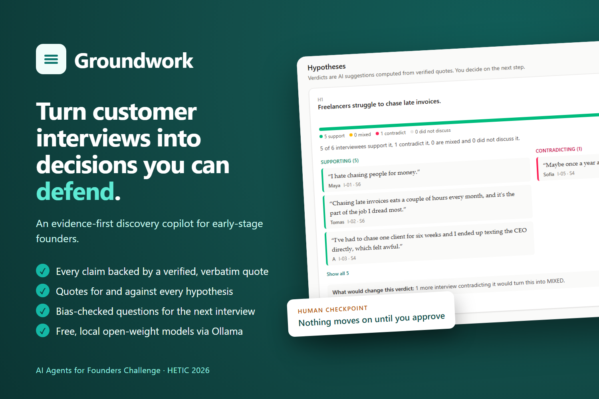
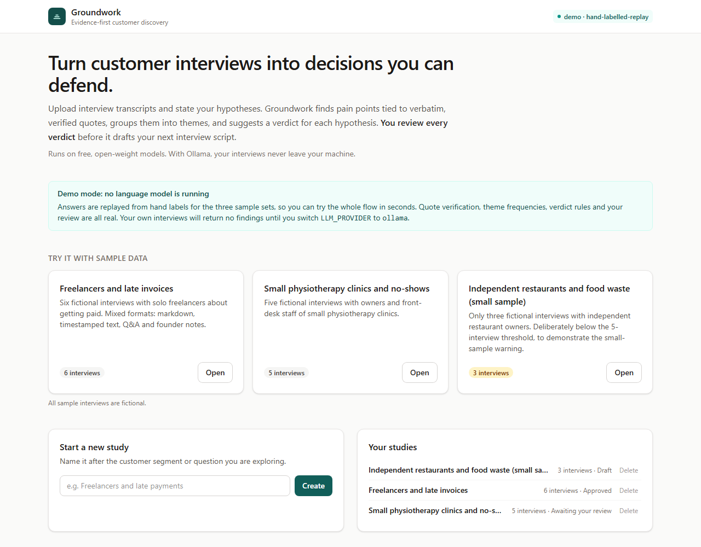
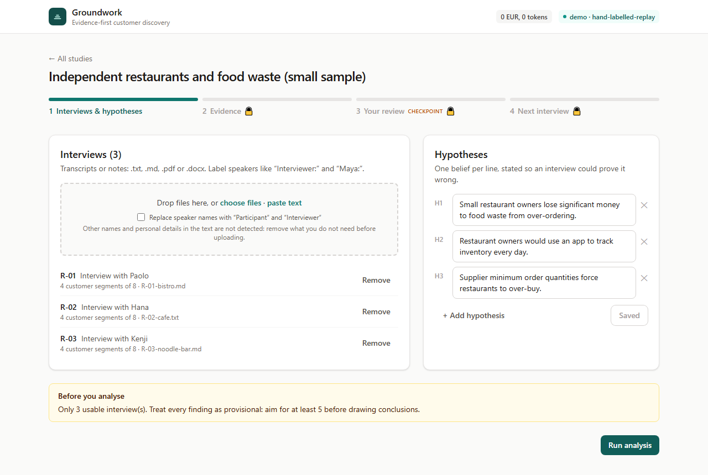
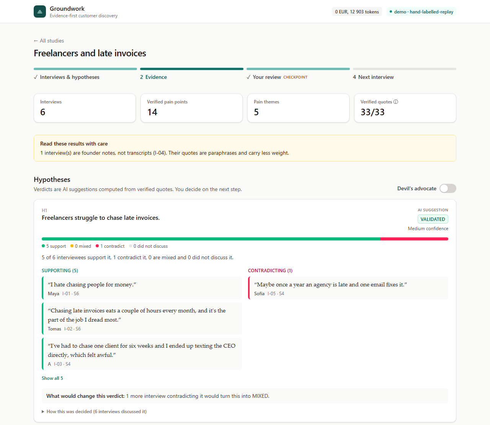
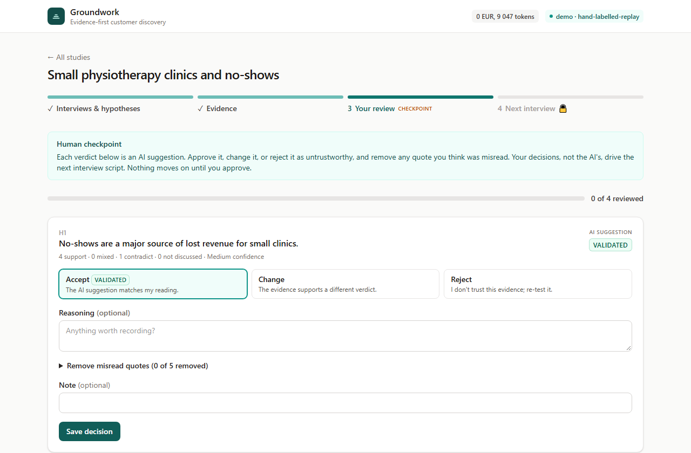
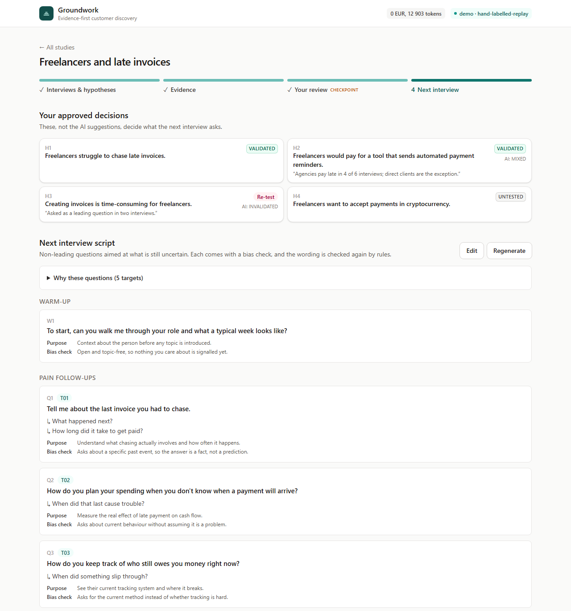

# Groundwork

**Evidence-first customer discovery copilot for early-stage founders.**
Entry for the *AI Agents for Founders Challenge (HETIC 2026)*.



<!-- Demo GIF: record the four-step flow in demo mode, save it as docs/demo.gif,
     and add  here. -->

## The problem

After a round of customer interviews, founders have hours of transcripts and a
list of hopes. Synthesis is slow, so it gets skipped or done from memory, and
memory is generous: the quotes that confirm the idea stick, the ones that
contradict it fade. Generic AI summaries make this worse. They paraphrase,
invent quotes and sound confident about three interviews.

Groundwork treats interviews as evidence:

- every pain point is backed by a **verbatim quote checked against the
  transcript** (unverified quotes are dropped, never shown);
- themes are counted by **distinct interviewees**, not by how much one person
  talked;
- each hypothesis gets a verdict (**VALIDATED, INVALIDATED, MIXED or
  UNTESTED**) computed by inspectable rules, with supporting and contradicting
  quotes side by side and a confidence note;
- a **human checkpoint**: the founder accepts, changes or rejects every
  verdict, and nothing downstream runs until they approve;
- the **next interview script** targets only what is still uncertain, with a
  bias check on every question;
- a **Markdown/PDF export** with the decision log, so every claim links back to
  its source.

The model proposes, code decides, the founder approves. See
[docs/architecture.md](docs/architecture.md).

## Screenshots

Taken in demo mode with the bundled (fictional) sample interviews.

**Home:** sample sets, your studies, and a banner when no model is running.



**Step 1, interviews and hypotheses:** upload or paste transcripts, optionally
replace speaker names, and state hypotheses. A warning shows below 5 interviews.



**Step 2, evidence:** verified quote counts, and for each hypothesis an AI-suggested
verdict with supporting and contradicting quotes side by side, each linked to
its interview and segment, plus what would change the verdict.



**Step 3, the human checkpoint:** accept, change or reject every verdict, remove
misread quotes and add notes. Step 4 stays locked until you approve.



**Step 4, next interview:** your approved decisions (with the AI's suggestion
where you disagreed) and a script that targets what is still uncertain, with
a purpose and a bias check for every question.



## Free by design

All runtime models are free: an open-weight model through
[Ollama](https://ollama.com) by default (data never leaves your machine), or an
optional free-tier hosted API (Groq). No paid APIs. Every model call is logged
with its token counts, latency and prompt version.

## Quick start with Docker

Requires Docker with Compose. The app is served at http://localhost:8080.

```bash
# Demo mode: no model needed, replays hand-labelled sample data
LLM_PROVIDER=demo docker compose up --build

# Ollama running on your machine (default provider)
ollama pull qwen2.5:7b
docker compose up --build

# Or Ollama in a container too
docker compose --profile ollama up --build
docker compose exec ollama ollama pull qwen2.5:7b
```

No `.env` is needed: Compose reaches an Ollama on your machine at
`host.docker.internal`. With the `ollama` profile, set
`OLLAMA_BASE_URL=http://ollama:11434` in the shell or a `.env` file (do not
copy the manual setup's `localhost` address into it). Data is kept in a Docker
volume.

## Quick start (manual)

**Backend** (Python 3.11+):

```bash
cp .env.example .env            # LLM_PROVIDER=demo to try it without a model
cd backend
python -m venv .venv
.venv/Scripts/activate          # Windows; `source .venv/bin/activate` elsewhere
pip install -e ".[dev]"
python -m scripts.check_llm     # one-shot provider smoke test
uvicorn app.main:app --reload   # API docs at http://localhost:8000/docs
pytest                          # test suite
```

**Web app** (Node.js 20+), with the backend running:

```bash
cd frontend
npm install
npm run dev                     # http://localhost:5173, proxies /api to localhost:8000
npm test                        # component and unit tests (Vitest)
```

Set `GROUNDWORK_API` to point the dev proxy at a backend on another address.

## Setting up Ollama

1. Install Ollama from https://ollama.com and start it (`ollama serve`, or the
   desktop app).
2. `ollama pull qwen2.5:7b` (about 4.7 GB; fits a 6 GB GPU and runs on CPU,
   slowly). `llama3.1:8b` also works: set `OLLAMA_MODEL`.
3. `python -m scripts.check_llm` from `backend/` checks the connection and
   structured output.

If the GPU runs out of memory, set `OLLAMA_FORCE_CPU=true`.

## Configuration

All settings come from environment variables; see [`.env.example`](.env.example).

| Variable | Default | Purpose |
| --- | --- | --- |
| `LLM_PROVIDER` | `ollama` | `ollama`, `groq`, `demo` (hand-labelled replay, no model) or `mock` (tests) |
| `OLLAMA_BASE_URL` | `http://localhost:11434` | Ollama server address |
| `OLLAMA_MODEL` | `qwen2.5:7b` | Any pulled Ollama model |
| `OLLAMA_FORCE_CPU` | `false` | Force CPU inference when the GPU is too small |
| `GROQ_API_KEY` | (empty) | Free-tier key, only for `LLM_PROVIDER=groq`. Never commit it. |
| `LLM_TEMPERATURE` / `LLM_SEED` | `0.1` / `42` | Deterministic generation |

## How judges can test it

1. **Demo mode, no model, about two minutes.** Start with
   `LLM_PROVIDER=demo` (Docker or manual). The home page shows a demo banner.
   Create a study from a sample set (freelance invoicing, physiotherapy clinics
   or restaurant inventory), run the analysis, read the evidence, review every
   verdict at the checkpoint, approve, draft the next interview script and
   export the report. Demo mode replays hand labels: it shows how the product
   works, not how well a model performs.
2. **With a real model.** Run Ollama as above and repeat with a sample set or
   your own transcripts (txt, md, pdf, docx or pasted text). Tick *Replace
   speaker names* on upload to redact names.
3. **Evaluation harness.** From `backend/`:

   ```bash
   python -m evals.run_eval --provider demo      # checks the harness itself
   python -m evals.run_eval                      # scores your configured model
   ```

   It reports the quote-verification rate, verdict agreement with the hand
   labels, per-interview stance agreement and pain-point recall for the three
   sample sets. See [backend/evals/README.md](backend/evals/README.md).
4. **Model usage.** `python -m scripts.usage_report` prints calls and tokens
   by provider, model and prompt. The export includes the same figures.
5. **Tests.** `pytest` and `ruff check .` in `backend/`; `npm test` and
   `npm run build` in `frontend/`.

## Documentation

- [Architecture](docs/architecture.md): pipeline and component diagrams, key
  decisions, failure states
- [Human judgment](docs/human-judgment.md): where the founder has the last word
- [Responsible AI](docs/responsible-ai.md): privacy, limitations, bias
- [AI disclosure](docs/ai-disclosure.md): models used at runtime and in development
- [Time-saved report](docs/time-saved-report.md): measured model workload and an estimate of about 5 to 10 h of synthesis cut to 15 to 30 min of founder time per round of 6 interviews
- [Sample data](samples/README.md) and [prompts](backend/prompts/README.md)

## API overview

| Endpoint | Purpose |
| --- | --- |
| `POST /api/studies` / `POST /api/studies/from-sample/{set}` | Create a study (blank or from sample data) |
| `DELETE /api/studies/{id}` | Delete a study and all its data |
| `POST /api/studies/{id}/interviews` (multipart) / `.../interviews/text` | Add interviews (txt, md, pdf, docx, or pasted text); optional name redaction |
| `PUT /api/studies/{id}/hypotheses` | Set the hypotheses to test |
| `POST /api/studies/{id}/analyze`, `GET .../status` | Run the analysis in the background and poll progress |
| `PUT /api/studies/{id}/reviews/{hypothesis}` | **Human checkpoint**: approve, change (with reason) or reject each verdict, remove quotes, add notes |
| `POST /api/studies/{id}/approve` / `.../reopen` | Pass the checkpoint (refused until every verdict is reviewed) or reopen it |
| `GET /api/studies/{id}/decisions` | Approved decisions; returns `409 checkpoint_required` before approval |
| `GET /api/studies/{id}/decision-log` | Append-only log of AI suggestions and founder decisions with timestamps |
| `POST /api/studies/{id}/script` / `GET` / `PUT` | Draft, read or edit the next interview script (gated by the checkpoint) |
| `GET /api/studies/{id}/report.md` / `report.pdf` | Export decisions, evidence with sources, themes, script, decision log and AI usage (gated) |

Interactive docs at http://localhost:8000/docs.

## License

[MIT](LICENSE)
