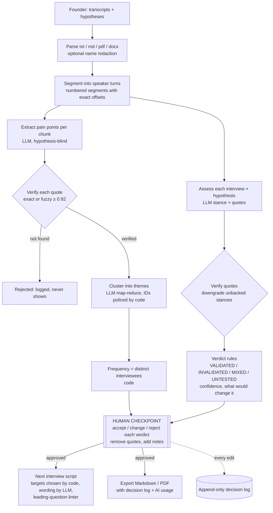
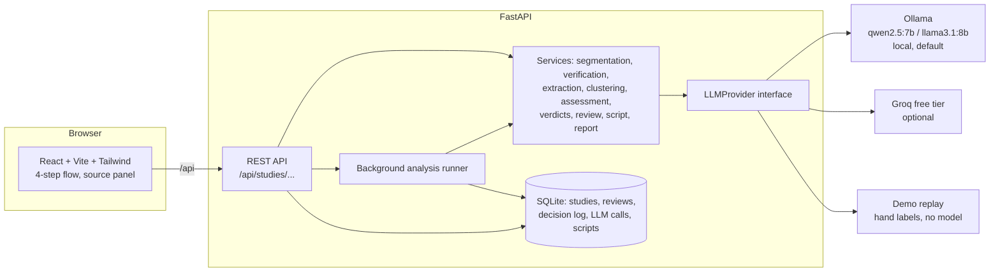

# Architecture

Groundwork is a FastAPI backend with a React frontend. One rule shapes the
design: **the language model proposes, code decides, the founder approves.**
The model only reads text and proposes quotes, groupings, stances and
question wording. Code checks every quote against the transcript, counts
frequencies, applies the verdict rules and lints the questions. Nothing after
the human checkpoint runs until the founder has approved every verdict.

## Pipeline

## Components

## Key decisions

| Decision | Why |
| --- | --- |
| Hypothesis-blind extraction | The model looks for pain without knowing what the founder hopes to find, which limits confirmation bias. |
| Quotes verified against the transcript | Small local models paraphrase and invent. Only text found in the transcript (exact, or fuzzy ≥ 0.92 with numbers and negations unchanged) is shown as evidence, always with interview, speaker and segment. |
| Verdicts by rules, not by the model | Rules are inspectable and stable: ≥ 2 interviewees and ≥ 75% agreement to validate or invalidate, never from a single interview, confidence capped below 5 interviews. The UI shows the rule and what would change the verdict. |
| Checkpoint enforced on the server | `require_approved` guards the script, the decisions and the export (409 otherwise). The disabled button in the UI is a convenience, not the gate. |
| Structured output with repair | JSON schema sent to the model (Ollama `format`), Pydantic validation, up to 2 retries with the validation errors fed back. |
| Versioned prompts | `backend/prompts/<name>.v<N>.md`. Every logged call records the prompt version. |
| Deterministic settings | Temperature 0.1, fixed seed, concurrency 1 by default (one local GPU). |
| SQLite with JSON columns | One file, no server. Analysis results are stored whole as validated Pydantic models. |

## Data model

- `studies`: name, status (`draft → analyzing → awaiting_review → approved`,
  or `failed`), hypotheses, transcripts, analysis result.
- `reviews`: the founder's current decision per hypothesis.
- `decision_log`: append-only; every AI result and founder edit with a
  before/after snapshot and a timestamp.
- `llm_calls`: provider, model, prompt version, tokens, latency, success.
- `scripts`: the next interview script (discarded when the review is reopened).

## Failure states

| Situation | What the user sees |
| --- | --- |
| Model server unreachable | "The language model could not be reached", with the command to start Ollama. |
| Model not pulled / key missing | "The language model is not set up", with `ollama pull ...`. |
| Model keeps returning invalid JSON | That chunk is skipped and listed in a warning. If every interview fails, the analysis fails ("The model kept returning unusable answers") instead of showing empty results. |
| Empty or unusable transcript | Rejected on upload with the reason. |
| Fewer than 5 interviews | Warning everywhere; confidence capped at LOW; approval needs an explicit acknowledgement. |
| Single interview supports a hypothesis | Never VALIDATED; at most MIXED or UNTESTED. |
| Server restart mid-analysis | Study marked failed ("interrupted"), can be re-run. |
